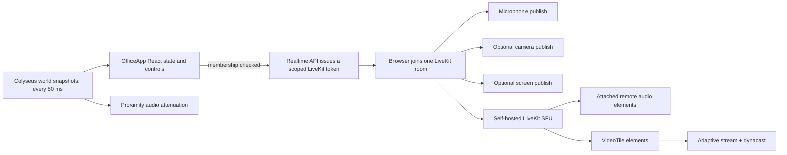

# Infrastructure and performance review

Reviewed: 2026-10-12

This is a review of the current checkout, a production build, the existing automated tests, and load-test artifacts already in `.loadtest/`. No live multiplayer or browser FPS test was run in this review. The historical measurements are machine- and setup-specific and are not capacity guarantees.

## What is in good shape

- The HTTP API, realtime world, media SFU, database, and static web server have distinct processes/containers. Production Compose has readiness checks for PostgreSQL, API, and realtime, plus restart policies.
- Realtime movement is server-authoritative. The world uses a 20 ms fixed timestep, a 50 ms state patch interval, caps input to at most one packet per 30 ms per player, and caps room messages (`packages/server/src/offices/OfficeRoom.ts:86-90,433-468`). High-frequency movement is not written to PostgreSQL; activity refresh is rate-limited (`OfficeRoom.ts:456-464`).
- Production config sets `ROOM_MAX_CLIENTS=150` and database pool limits of 10 per API/realtime process (`compose.production.yaml`). The current load evidence does not validate that cap under the intended production conditions.
- The room and render code dispose many Three.js resources on teardown, and the renderer caps device pixel ratio at 1.75 (`packages/client/src/world/WorldCanvas.tsx:698-704`).

## Findings to address

### P1 — Restore a passing, meaningful test baseline

`pnpm build` passed: shared/server/client type checks and production bundles completed. The production client build warns about chunks over 500 kB; the output has a 1,417.42 kB main JS chunk (370.49 kB gzip) and a 583.03 kB LiveKit chunk (153.17 kB gzip).

Both available test commands currently fail:

- `pnpm test`: 11 passed, 1 failed. `packages/shared/src/index.test.ts:66-69` force-unwraps a campus room of kind `restroom`; the current `CAMPUS_LAYOUT` has no matching room, so `campusPropPlacements(undefined)` throws. Decide whether restroom fixtures should exist in this campus; then update the world or make the test match the current supported layout.
- `pnpm --filter @gammyverse/server test`: 0 passed, 1 failed. `packages/server/src/auth.test.ts:28-29` expects a user object without `characterId`, but the current auth service returns `characterId: null` for file-backed registration (`packages/server/src/auth/service.ts:81,115`). Align the contract and tests intentionally.

Failing tests make it harder to distinguish a performance regression from unrelated functional changes. Fix these before relying on CI as a performance optimization gate.

### P1 — Split and measure the browser bundles

The largest client chunk is 1.42 MB minified before gzip, with LiveKit adding another 583 kB. Defer LiveKit until a media feature is opened, and lazy-load route/editor/preview-only code where possible. Review Vite `manualChunks` only after the import graph is split; manual chunk naming alone will not defer downloads. Record initial compressed transfer, JS parse/evaluate time, and time-to-interactive on representative desktop and mobile devices.

### P1 — Remove repeated player/object scans from the render loop

In the Three.js frame update, every animated door scans all players (`WorldCanvas.tsx:2378-2388`). Each frame also rebuilds occupied-vehicle collections and scans all players for each driveable prop (`WorldCanvas.tsx:2395-2406`). This repeats work and allocates arrays/sets continuously; cost grows with player count and placed vehicles/doors. Compute proximity/occupancy once per frame or update derived indexes when players change, and avoid array spreads inside per-object loops. Profile before and after with 1/10/25/50 players and increasing prop counts.

The 2D overview canvas also projects and redraws every player and map element each animation frame (`WorldCanvas.tsx:3065-3095`). Consider drawing static layers only when map/layout/camera changes, while updating player markers separately at a lower cadence.

### P2 — Make static asset caching explicit

The production Caddy configuration serves the web root with `file_server` and does not set explicit cache lifetimes (`Caddyfile:25-28`). The Vite output uses content-hashed filenames, so configure long-lived immutable caching for hashed assets and revalidation/no-cache behavior for `index.html`. Confirm the actual response headers and repeat-load transfer in a browser.

### P2 — Reduce scene startup and GPU work based on profiles

The scene enables antialiasing, soft shadow maps, and shadows on many meshes (`WorldCanvas.tsx:698-701` and scene construction). These are reasonable visual defaults but can be costly on integrated GPUs and mobile. Benchmark with representative hardware; then consider quality tiers, fewer shadow casters, or disabling expensive effects at low device budgets. Also measure scene setup and asset loading on room/layout changes before optimizing blindly.

## Existing load-test evidence and limits

- `.loadtest/media-audio-results.csv` and `.loadtest/media-video-results.csv` report zero publisher errors at 10–100 simulated publishers. These are publisher connection checks; they do not establish real-browser FPS, subscriber fanout quality, latency, packet loss, audio/video quality, or usable user capacity.
- `.loadtest/office-stats.csv` contains roughly 150 one-second container samples from an earlier run. The recorded LiveKit container rises from about 42.5 MiB to 696 MiB and peaks at about 80% CPU; the office container starts around 576 MiB and ends around 643 MiB, with a recorded CPU peak around 27%. The host limit shown is 15.54 GiB. These figures are useful as a follow-up lead, not a reliable per-user cost: the CSV does not bind measurements to a controlled profile of room users, browser subscribers, active tracks, or device/network conditions.
- The existing office harness defaults to 100 users and sends one movement input per client per second (`.loadtest/office-load-test.mjs:4-8,171-179`). That verifies basic join/state behavior but does not model interactive movement cadence near the server's 30 ms input guard. Add a reproducible profile with staged users, realistic input cadence, active/idle mix, track subscriptions, and client/server metrics.

## Suggested order

1. Fix the two failing test assumptions/contracts and keep `pnpm build` plus all package tests green.
2. Add client chunk deferral and explicitly cache hashed production assets.
3. Optimize the per-frame player/door/vehicle scans, then verify gains with a browser profile.
4. Establish a repeatable 1/10/25/50-user baseline recording p50/p95 join time, client FPS/frame-time, server tick overruns, CPU/RSS, outbound traffic, database pool use, and media subscription quality.
5. Use those results to set a supported single-office capacity and browser quality tiers before increasing production room limits.

## Deep review: UI rendering, voice, camera, and screen share

### Current end-to-end flow

The current client has three mutually exclusive media-room flows: meeting, private desk, and proximity voice. Entering a different zone leaves one room and joins another. On join it fetches a short-lived token, creates a LiveKit `Room`, connects, and enables the microphone. Camera and screen share use the active room. The server verifies meeting/private/proximity membership before issuing each token and allows only microphone, camera, and screen-share publishing, with data publishing disabled (`packages/server/src/entrypoints/realtime.ts`, `packages/server/src/media/service.ts:41-82`).

The client already uses `adaptiveStream: true` and `dynacast: true` for all three room types (`OfficeApp.tsx:819,882,932`). Video tiles attach the LiveKit track to the actual `<video>` element and detach it on unmount (`OfficeApp.tsx:197-209`). This matches LiveKit's documented requirement for adaptive-stream visibility/size tracking. LiveKit describes adaptive stream as pausing hidden video and selecting a suitable resolution; dynacast pauses unused publisher layers. [LiveKit track subscription and adaptive stream](https://docs.livekit.io/transport/media/subscribe/), [LiveKit simulcast and dynacast](https://docs.livekit.io/transport/media/advanced/).

### Highest-priority media/UI findings

#### P1 — A video unsubscribe can disable proximity volume updates for that speaker

In the proximity room's `TrackUnsubscribed` handler, the code unconditionally deletes `proximityAudioTracksRef.current` by participant identity (`OfficeApp.tsx:835-839`). The map contains that participant's audio track, but the callback runs for any unsubscribed track. When their camera or screen share stops, it can therefore delete the still-published microphone entry. Future world snapshots no longer update that speaker's distance volume (`OfficeApp.tsx:797-805,1963-1968`), leaving audio stuck at its last gain until the audio track itself is resubscribed or the room is rebuilt.

**Recommended fix:** only remove a proximity audio entry when the unsubscribed track is audio and the entry still points to that exact track. Keep video cleanup separate. Add a regression check for: join proximity, hear a nearby user, publish/stop camera or screen share, walk to the edge/outside the audible radius while still in the same voice group, and verify volume continues to track distance.

#### P1 — Any new remote video can open the modal and steal focus

`addVideoTile` always selects the added track and opens the full-screen media popup (`OfficeApp.tsx:372-375`). It is used by every `TrackSubscribed` video callback, not only a local publish (`OfficeApp.tsx:824-833,887-894,936-944`). Consequently, another person's camera or screen share can open the popup for every viewer and replace the currently focused tile. In a multi-person meeting, tracks arriving close together can repeatedly change the focus. Opening the popup also mounts the video elements and triggers decode/render work for visible tiles.

**Recommended fix:** remote subscription should update the track list without opening the modal or changing focus. Open it on a local publish if that is intentional, or on explicit user action. Preserve a user's pinned/focused tile through resubscription and zone changes. Add a test that subscribes to multiple remote video tracks while the popup is closed and another while a user has a chosen tile focused.

#### P1 — Default 1080p/60 capture is an aggressive baseline

The camera capture requests 1920×1080 at 60 fps and publishes with a 4.5 Mbit/s maximum while preferring frame rate under degradation (`OfficeApp.tsx:233,1081-1092`). Screen sharing requests 1920×1080 at 60 fps, publishes up to 8 Mbit/s, prefers resolution under degradation, and labels the content as `motion` (`OfficeApp.tsx:234,1094-1105`). These are ceilings/requests, not promises that a browser, camera, hardware encoder, or network can sustain them. If a user enables camera and screen share together, both publication pipelines can run concurrently; the current UI does not select a lower profile for that combination.

This costs battery, encoder time, heat, upload bandwidth, SFU forwarding, subscriber bandwidth, and decode capacity. A 50-user office should not treat 1080p60 as the default all-participant profile. Start with a tested camera profile such as 720p/30 and a lower bitrate, promote quality for the focused tile or explicit user choice, and reserve 60 fps for a measured need. For screens, use a detail/text-oriented content hint for slides, documents, and code; use motion for high-motion content. LiveKit's JS screen-capture options expose `detail`, `text`, and `motion`; the current implementation explicitly picks `motion`. [LiveKit screen-share options](https://docs.livekit.io/reference/client-sdk-js/interfaces/ScreenShareCaptureOptions.html), [LiveKit publishing options](https://docs.livekit.io/reference/client-sdk-js/interfaces/TrackPublishOptions.html).

**Recommended UI change:** replace the unconditional “Target 1080p · up to 60 FPS” badge with “Up to …” wording and, if useful, measured actual dimensions/fps. Keep the capture request, negotiated/encoded quality, and the UI promise aligned.

#### P1 — TURN/TLS fallback is not exposed in the production Compose ports

Production config enables the LiveKit server, ICE/TCP 7881, ICE/UDP mux 7882, TURN/UDP 3478, and a TURN relay UDP range 30000–30500 (`compose.production.yaml:2-24`). Caddy serves the LiveKit signaling hostname over TLS, but the Compose file does not publish a TURN/TLS listener/port. This means the configured paths do not establish a TURN/TLS fallback for networks that block UDP and the direct ICE/TCP route. LiveKit lists TURN/TLS as a separate optional connectivity path and documents the public ports/firewall requirements. [LiveKit ports and firewall](https://docs.livekit.io/transport/self-hosting/ports-firewall/), [LiveKit connection paths](https://docs.livekit.io/intro/basics/connect/).

**Recommended action:** decide which network environments must work. For a public office product, validate at least direct UDP, TURN/UDP, ICE/TCP, and a TCP/TLS-only corporate network. Configure a supported TURN/TLS endpoint and expose the corresponding listener/port if that last case is in scope. Confirm the TLS proxy/domain arrangement against LiveKit's deployment guide rather than assuming the normal HTTPS/WebSocket proxy on 443 also forwards TURN/TLS. Record the selected ICE candidate type and relay fraction in tests. The current README and `PROJECT_DOCS.md` correctly say external TURN/firewall verification is still outstanding.

#### P1 — Screen-share audio is not requested

The permissions check calls `getDisplayMedia({ video: true, audio: false })` (`OfficeApp.tsx:704-712`), and the actual `SCREEN_CAPTURE_1080P60` options set resolution/content hint but no `audio` capture option (`OfficeApp.tsx:234,1094-1105`). Therefore this feature requests screen video only; the UI should not imply tab/system audio is shared. If screen audio is a product requirement, add a separately explained, browser-supported opt-in and publish/stop lifecycle. Browser support varies, as LiveKit's screen-share options also document for audio capture. [LiveKit screen sharing](https://docs.livekit.io/transport/media/screenshare/), [LiveKit `ScreenShareCaptureOptions`](https://docs.livekit.io/reference/client-sdk-js/interfaces/ScreenShareCaptureOptions.html).

### Video rendering and React behavior

- **Strong foundation:** LiveKit video is rendered through attached video elements rather than copied into the Three.js canvas. The foreground element uses `object-fit: contain`, which preserves the whole shared screen. Local preview elements are muted and `playsInline`, avoiding local echo and forced iOS fullscreen (`OfficeApp.tsx:197-209`; `styles.css:406-417`).
- **Tile count still scales linearly:** the popup renders every secondary track in a horizontally overflowing strip (`OfficeApp.tsx:2432-2434,2626-2629`). Adaptive stream should reduce received video for hidden/offscreen attached elements, but each tile still has React/DOM/observer/attachment lifecycle cost. Add an explicit visible-tile limit, pin/active-speaker selection, or virtualization before targeting large meetings; keep audio subscription independent of video tile visibility.
- **Screen thumbnails use camera-style cropping:** compact tiles use `object-fit: cover` (`styles.css:407-418`), while the large focused tile uses `contain`. Screen shares are mostly text/UI where edge cropping is costly. Add a screen-share class based on track source and use `contain` for compact screen previews too.
- **OfficeApp is a very large stateful component:** media booleans, tile selection, voice state, permissions, office UI, and world UI all live in `OfficeApp.tsx`. Every media-state transition rerenders the parent. This is manageable at low event rates, but track churn plus several dozen tiles can make React work compete with WebRTC decode and the Three.js render loop. Extract media lifecycle/state into a focused hook or controller and memoize tile/list/panel subtrees after profiling. Keep high-rate position data in refs/external stores, not React state.
- **Snapshot work is repeated at the state cadence:** each Colyseus update builds a new snapshot map, updates local presence/audio state, then rebuilds and sorts a string signature for all players (`OfficeApp.tsx:1963-1977`). The signature includes vehicle coordinates, so driving updates can also trigger `setPeople` and rerender UI at snapshot cadence. Compare stable fields incrementally or derive a version/event signal; only rebuild the people list when those fields actually change. Keep player positions out of React state.
- **Proximity attenuation can be quadratic:** on each world state update, `updateProximityAudioVolumes` loops audio tracks and scans all players to find each speaker by display name (`OfficeApp.tsx:797-805,1968`). At N nearby users this is approximately N² lookup work, repeated about 20 times per second. Build a username-to-player index once for each snapshot (or map LiveKit identity to session/username once), then compute each distance in O(N). Profile whether 10–15 Hz attenuation updates are sufficient, with immediate recalculation on group/track changes.
- **Potential async-toggle race:** camera/screen toggles use React booleans and update state only after awaited capture/publish calls (`OfficeApp.tsx:1081-1105`). Rapid repeated clicks can start overlapping enable/disable operations using the same stale state. Add a per-source busy/in-flight guard and reflect pending state; ensure errors/cancelled pickers restore the actual SDK publication state.
- **Modal accessibility:** the fullscreen popup has `role="dialog"`, `aria-modal`, and an Escape handler (`OfficeApp.tsx:2626-2633,790-795`). Verify initial focus, focus containment, focus restoration to the opener, and keyboard selection of tiles. A visible dialog role alone does not make a modal's focus lifecycle accessible.
- **Autoplay and device differences:** video uses `autoPlay` and LiveKit's attach behavior; remote audio uses hidden attached audio elements with `autoplay` (`OfficeApp.tsx:493-498`). Run permission/autoplay testing on Safari iOS/macOS, Chrome Android, and desktop Chrome/Firefox. Capture browser errors for rejected `play()` and provide an explicit “Enable audio” recovery affordance.

### Voice behavior and cost

- **Positive:** proximity gain is based on world distance, uses a smooth curve, and mute/status applies to attached remote audio elements (`OfficeApp.tsx:450-453,797-805`). Voice groups are membership-derived on the authoritative world server. Tokens are issued only after server-side checks and carry only the required media source grants (`packages/server/src/entrypoints/realtime.ts:47-80`, `packages/server/src/media/service.ts:41-82`).
- **Room handoff churn:** moving between proximity/private/meeting channels disconnects one SFU room and requests/connects to another (`OfficeApp.tsx:1108-1136`). This can produce an audible gap and repeated signaling/ICE work around boundaries. Measure handoff p50/p95 and short-path movement across zone edges. Add boundary hysteresis/grace only if it does not widen private-zone access; consider explicit connection status and a brief reconnect state. Avoid joining adjacent private rooms as a prewarm because that weakens access boundaries.
- **The microphone starts immediately on voice-room join:** each join flow calls `setMicrophoneEnabled(true)` after connect (`OfficeApp.tsx:848-852,901-905,952-956`). This is coherent with walk-up voice but means entering a voice zone starts capture/publish unless permission blocks it. Keep an unmistakable live/muted indicator, document this behavior, and test that leave/status transitions actually stop publication and release device capture.
- **No explicit per-user outgoing audio profile:** audio uses SDK/browser capture defaults. Measure the target speech codec/bitrate, echo cancellation, noise suppression, and automatic gain control on representative headsets/laptops. Do not enable heavier DSP by default without evidence; browser WebRTC processing and headset hardware vary.
- **Remote track cleanup:** the app attaches one audio element per remote audio track and removes subscribed video elements on unsubscription. Verify the audio elements are removed on track unpublish, room disconnect, logout, and quick zone transitions; check for duplicate elements/streams after reconnect.

### Server/media capacity and deployment

- One user may publish audio, camera, and screen as separate sources; all peers in that LiveKit room can subscribe. With a large meeting, outgoing SFU traffic depends on how many tracks are actively forwarded to each subscriber, codec/layers, resolution, and relay use. Do not estimate capacity from publisher-only success rows. Model subscribers and record per-track bitrate, forwarded layers, packet loss, RTT, jitter, and TURN relay usage.
- `adaptiveStream` and `dynacast` are good defaults here, but their benefit depends on video elements being attached, visible state being accurate, supported browsers, and simulcast layers being available. LiveKit notes that JS adaptive stream requires `Track.attach()`; the current `VideoTile` follows that requirement. Verify browser support and actual layer selection rather than assuming it from the option flags. [LiveKit subscription guide](https://docs.livekit.io/transport/media/subscribe/), [JS SDK browser support](https://docs.livekit.io/reference/client-sdk-js/).
- Production LiveKit has no Compose health check; realtime starts when LiveKit is `service_started` (`compose.production.yaml:98-102`). This is startup ordering, not proof signaling/media ports are ready. Add a practical health/smoke check and alert on media connection failures; token issuance readiness alone cannot prove UDP/TURN reachability.
- LiveKit media bypasses API/realtime and connects browser-to-SFU, so the API's ordinary HTTP health check and the existing office movement load test say little about media health. Add ICE candidate and media-stat collection in an opt-in diagnostic flow. Do not log raw media or credentials.

### Detailed verification plan

Run this in staging from at least two networks, including a restricted TCP/TLS-only network. Keep client versions, server image/version, VM shape, geography, browser version, device, and network impairment fixed between runs.

| Scenario | Clients/publishers | Main observations |
| --- | --- | --- |
| Office baseline, no media | 1 / 10 / 25 / 50 | Browser FPS/frame-time, long tasks, heap, WebGL draw calls, realtime tick overruns, CPU/RSS, network bytes |
| Proximity audio | 2 / 10 / 25 speaking and silent | Join/handoff latency, active tracks, per-client receive bitrate, speaker gain vs distance, mute/leave cleanup, audio gaps, CPU |
| Meeting voice | 10 / 25 / 50 with 1/4/10 concurrent speakers | Egress/ingress, loss, RTT, jitter, audio underruns, SFU CPU/RSS, TURN fraction |
| Camera grid | 1 / 4 / 10 / 25 active cameras with staged subscribers | Publish capture vs actual dimensions/fps, simulcast layers, decoder CPU, received bitrate, visible/offscreen adaptation, tile mount cost |
| Screen share | 1/3/10 sharers; slides/code and moving video; camera on/off | Text readability, content hint, actual fps/bitrate, capture/encode CPU, visible thumbnail crop, tab/system audio behavior |
| Churn and network faults | zone boundary crossings, rapid toggle, reconnect, UDP blocked, packet loss/RTT injection | No duplicate room/track/audio elements, no stale volume/focus, bounded retries, useful UI error, candidate/relay path |

Capture WebRTC inbound/outbound stats (bytes/bitrate, frames encoded/decoded, dimensions/fps, packets lost, jitter, RTT, selected candidate pair and candidate type) alongside browser performance traces. For the scene also capture frame-time p50/p95, `renderer.info` calls/triangles/geometries/textures, memory, and long tasks. On the host capture per-container CPU/RSS/network and LiveKit participant/track counts. Report p50 and p95, not just averages. Use the LiveKit CLI/SDK benchmarks for infrastructure stress only as a supplement to real-browser tests; the old `.loadtest/media-*-results.csv` currently reports only simulated publishers and errors.

## External technical references

- [LiveKit adaptive stream and subscription](https://docs.livekit.io/transport/media/subscribe/)
- [LiveKit simulcast and dynacast](https://docs.livekit.io/transport/media/advanced/)
- [LiveKit camera/microphone and publishing](https://docs.livekit.io/transport/media/publish/)
- [LiveKit screen sharing](https://docs.livekit.io/transport/media/screenshare/)
- [LiveKit JavaScript `ScreenShareCaptureOptions`](https://docs.livekit.io/reference/client-sdk-js/interfaces/ScreenShareCaptureOptions.html)
- [LiveKit self-hosted ports and firewall](https://docs.livekit.io/transport/self-hosting/ports-firewall/)
- [LiveKit connection paths](https://docs.livekit.io/intro/basics/connect/)

## Implementation follow-up

Reviewed and verified on 2026-10-12:

- Proximity audio cleanup now removes an entry only when the unsubscribed track is the same audio track stored for that participant. Speaker lookup builds one online-player index per volume update instead of scanning the player list for every track.
- Remote camera and screen tracks no longer open the media popup or replace the focused tile. The default tile fallback is stable when no explicit selection exists; local publishing can still open the local media preview.
- Camera defaults are now 720p/30 FPS with a 1.5 Mbit/s encoding ceiling. Screen share defaults to 1080p/30 FPS with a 4 Mbit/s ceiling and a detail-oriented content hint. The UI labels these as targets because actual capture/encoding depends on browser, device, and network.
- The world render loop precomputes driveable prop definitions, indexes vehicle occupancy once per frame, and avoids temporary player arrays and square roots in door proximity checks. The 2D overview redraws only when camera, canvas size, or player display state changes.
- Production Caddy now marks hashed Vite bundles immutable and the SPA index.html as revalidatable. The route order applies the HTML cache rule after SPA fallback rewriting.
- The two previously failing test assumptions were updated: the current campus layout is intentionally empty, and registration/session results include characterId: null.

Validation: pnpm test passed (12 shared tests), pnpm --filter @gammyverse/server test passed (1 test), and pnpm build passed. docker compose config --quiet and git diff --check passed. The Vite build still reports its existing large-chunk warning. No browser performance benchmark, live multi-client media scenario, Caddy parser validation, or production network/TURN test was run. TURN/TLS remains a deployment task requiring a public DNS name, certificate, firewall exposure, and connectivity tests on the target networks.

### Review update — 2026-10-15

- Voice control drains are scoped to a room generation, so a pending browser media-permission request in an old room cannot block or unlock controls in the replacement room. Local media tiles continue to reconcile on all callbacks, while only a newly published local video track opens the popup or changes its focus.
- Scale-100 skinned pet GLBs require private parses because cloning these rigs with the shared template produced invisible skinning. Private geometry, materials, textures, and skeletons are now disposed on stale completion, pet replacement/departure, and world teardown. Active users still hold separate parsed mesh resources; measure renderer memory and parse time with many pet-owning participants before setting a high-density target, then evaluate sharing mesh resources while keeping skeletons independent.
- Account role changes and suspensions now canonicalize usernames before database mutation and realtime invalidation. Retrying after a failed realtime kick repeats the kick for persisted role changes and suspensions.
- Validation on this worktree: `pnpm test` passed (51 shared + 140 client tests), `pnpm --filter @gammyverse/server test` passed (105 tests), server TypeScript check passed, and `pnpm build` passed. Vite still warns that the main JavaScript chunk is 1.86 MB (457 kB gzip), with LiveKit at 561 kB; route-level/demand-based code splitting remains a likely improvement to measure.
- Browser rendering, camera/microphone permission prompts, two-session zone/meeting transitions, GPU profiling, and network/TURN tests were not verified in this pass.
